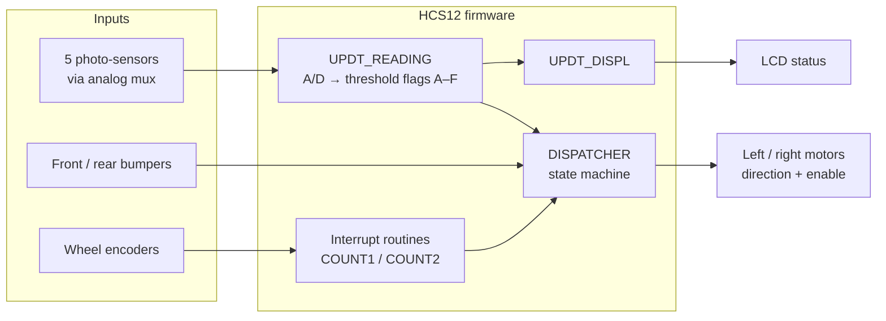
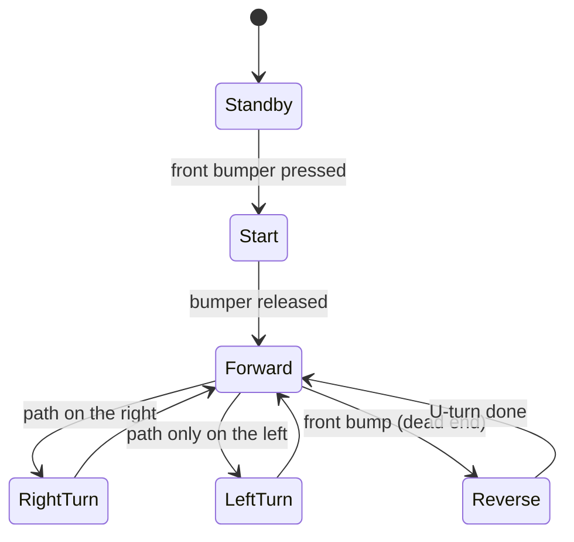

# Maze-Solving Bot

Assembly firmware that lets a small two-wheeled robot follow a line through a maze on its own, using light sensors, bumpers, and wheel encoders.

**Tech Stack:** HCS12 assembly (MC9S12C32 microcontroller) · CodeWarrior IDE · eebot robot platform

## Features

- **State-machine control:** a central dispatcher runs the current state (standby, start, forward, right turn, left turn, reverse) on every loop.
- **Line sensing:** five photo-sensors read through an analog multiplexer and the A/D converter, then compared against tuned thresholds.
- **Intersection handling:** detects right, left, and straight paths at L- and T-intersections, and prefers turning right.
- **Dead-end recovery:** a front-bumper hit makes the robot reverse, U-turn, and take the alternate path.
- **Live status display:** the LCD shows the current state, raw sensor readings, battery voltage, and bumper status.

In the final demo, the robot navigated the maze from start to finish.

## New to embedded systems?

- **Microcontroller (HCS12):** a small computer on a chip that reads sensors and drives motors directly.
- **Assembly language:** the CPU's own instructions written in readable form; no operating system underneath.
- **A/D converter:** turns a sensor's voltage into a number (0–255 here).
- **Interrupt:** hardware briefly pauses the main program to run a short routine, here to count wheel-encoder pulses.
- **State machine:** the robot is always in exactly one named state, and sensor events move it to the next.

## Architecture

The main loop repeats three steps forever: read the sensors, update the display, and run the current state. Each state routine uses the sensor flags, bumpers, and distance counts to decide whether to keep going or switch states. Distances for straight moves, turns, and U-turns are measured in wheel-encoder counts collected by interrupts.

### State machine

While moving forward, the robot also nudges left or right whenever the line sensor drifts off center.

## Technical Decisions & Challenges

- **A dispatcher-based state machine.** Each state is its own routine, and the dispatcher jumps to it. This kept driving, turning, and dead-end recovery separate and easy to tune on the track.
- **Distance by encoder counts.** Interrupt routines count wheel pulses, so moves and turns are defined in counts rather than fixed time delays.
- **Tuning turns.** At first the robot turned past 90° and lost the line at intersections. Lowering the motor speed and adjusting the turn-distance constants fixed it.

## Limitations

- Needs the eebot hardware and CodeWarrior for HCS12 (which provides the `derivative.inc` chip header); it can't run on a regular computer.
- Sensor thresholds and distances are hand-tuned constants for one robot and track.
- Turns are open-loop (counted encoder pulses), not corrected against the line during the turn.

## Next Steps

- Calibrate the sensor thresholds automatically at startup.
- Use closed-loop (PID) line following for smoother, faster runs.
- Record the route through the maze and take the shortest path on later runs.
- Port the state machine to C with a PC simulator, so the logic can be tested without hardware.

---

Built as a team project (2 members).

**Credits:** the support routines at the end of [`src/main.asm`](src/main.asm) (sensor reading, LCD driver, delays, number conversion, display, and hardware setup) are adapted from the eebot reference routines by Peter Hiscocks. The state machine and navigation logic are the team's own.

## License

[MIT](LICENSE), except for the adapted support routines credited above, which remain their original author's work.
